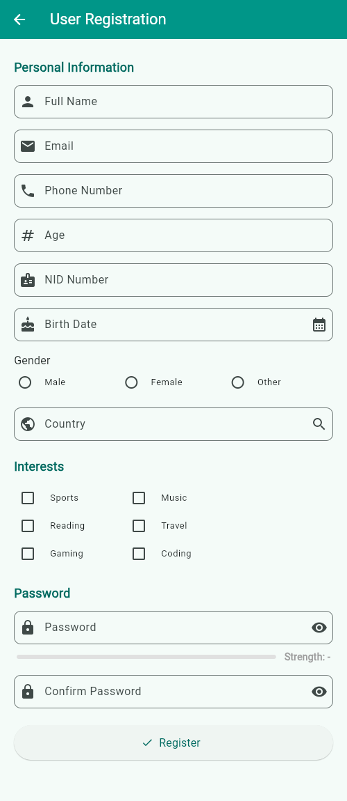
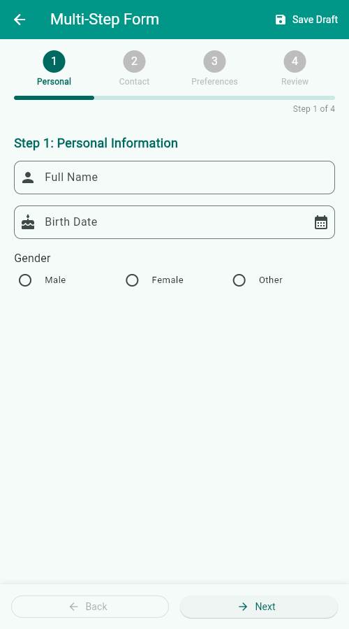

# CSE 464 – Group Assignment: Forms with Validation

**Name:** Tanvir Ahmed Aditto  
**IUB ID:** 2110457  
**Course:** Mobile App Development (CSE 464)

Hands-on projects from the `flutter-navigation-and-forms-with-validation` branch of the course repository, built with Flutter and Dart only (no extra packages).

## Part 1: User Registration Form

Name, email, phone, age and NID fields; password with a strength bar; searchable country field; gender radio buttons; interest checkboxes; birth-date picker. All validation uses the custom `Validators` class in [`lib/utils/validators.dart`](lib/utils/validators.dart).



## Part 2: Multi-Step Form Wizard

Four steps (Personal → Contact → Preferences → Review & Submit), a progress indicator, Back/Next with validation, and Save Draft.



## How to Run

```bash
flutter pub get
flutter run -d chrome
flutter test
```
